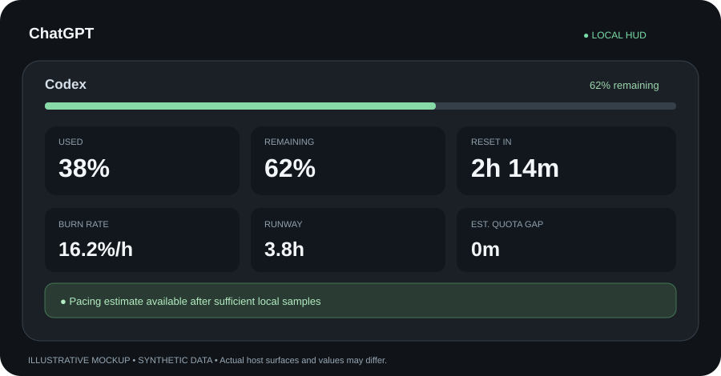

# QuotaPilot

**Language / Idioma: English · [Español](README.es.md)**

**Know your AI limits before they interrupt your work.**

**License: [MIT](LICENSE)** · Copyright © 2026 Cibersecurity-H

QuotaPilot is an **open-source, local-first AI usage HUD** for Codex, Claude Code and compatible ChatGPT Desktop plugin hosts. Its visible name matches your host (**Codex**, **Claude Code**, **ChatGPT**; fallback **AI Usage**). The technical package ID remains `quota-pilot`.

> **Public source · 0.6.0-rc.4 release candidate.** Automated checks are green; **real-host installation and PiP compatibility are awaiting user testing**. This repo is not yet listed in the universal ChatGPT/Codex Plugins Directory.

The HUD provides provider-reported **used**, **remaining** and **reset time**, plus **burn rate**, **estimated runway** and **visual quota alerts** when enough telemetry exists. Forecasts are estimates—not billing, guaranteed provider limits or desktop-wide notifications. Unknown data is shown as unavailable.

**ChatGPT Desktop permissions:** decline broad requests to install the Codex footer or write into `.quotapilot` from a ChatGPT Work session. The official ChatGPT plugin manager may itself save enable/disable preferences in `~/.codex/config.toml`; that is separate from a script editing the native Codex footer. [Host-specific guidance](docs/AGENT-INSTALL.md).

## Windows Git marketplace: bundled runtime, no Node installation

**Upgrading from 0.6.0-rc.3:** refresh the **AI Usage** marketplace/install through ChatGPT Desktop Plugins management and restart the application completely. The previous version can remain in the plugin cache without the native executable. Then open a **new local Desktop conversation**, select AI Usage via @ or the composer Plugins selector, and verify that `get_overview` / `open_hud` are actually exposed as MCP tools. Seeing skills alone does not confirm a working MCP connection. Do not request additional filesystem permissions or configure the Codex footer to work around a missing local executor.

The **Windows x64 GitHub marketplace now carries its own Node.js runtime** at `runtime/node.exe` (directly checked into the repository, under official Node licensing). The root `mcp.json` starts `./runtime/node.exe` rather than a system `node` command. **No ZIP download, PowerShell command or Node/npm install is required of the user** when a compatible **local** host installs the complete repository. The plugin server never downloads its runtime on startup. Confirm `runtime/NODE-PROVENANCE.json` before installing. This increases repository size.

**macOS/Linux:** use the platform-specific prepackaged marketplace/release; this Windows source manifest is not a universal launcher. If ChatGPT is running in a cloud session or does not execute local stdio MCP, even the bundled executable cannot open the HUD.

## Install without a setup loop

**ChatGPT Desktop:** open the official **Plugins** browser, install/enable **AI Usage → quota-pilot** from a compatible local marketplace, and try `open_hud`. **Do not ask a ChatGPT Work agent to run a Codex installer.** The plugin requires a local stdio MCP executor; a GitHub link alone does not provide it, and the local ChatGPT feature remains unverified on some builds. An existing ChatGPT plugin manager may store enable/disable preferences in `~/.codex/config.toml`, but QuotaPilot's ChatGPT setup must never configure the Codex CLI footer or create `.quotapilot` itself.

**Codex CLI or Claude Code:** if your agent has a terminal **on your computer**, paste **https://github.com/csecurh/quota-pilot** and explicitly name your host. The agent can use the SHA-256 pinned portable installer with explicit host selection, without asking you to install Node/npm manually. [English instructions](docs/AGENT-INSTALL.md) · [Español](docs/es/AGENT-INSTALL.md).

## Alternative: manual portable release

**Recommended:** download the right archive from [QuotaPilot 0.6.0 portable releases](https://github.com/csecurh/quota-pilot/releases/tag/v0.6.0-rc.4). Windows x64, Linux x64 and both macOS architectures include their own Node.js runtime and license notices. Extract the archive, then add its folder as a **local marketplace/plugin** in a compatible host. **No separate Node/npm installation.** [Full guide](docs/PORTABLE.md) · [Guía en español](docs/es/PORTABLE.md).

The bundled runtime **does not** provide a Codex account or authenticated Codex executable: Codex quota data still requires the original Codex application. ChatGPT Desktop requires local MCP Apps support. Installing this ZIP does not put the plugin in the universal directory or guarantee global PiP.

## Developer source commands (Node.js required for development or non-Windows checkout)

**Source installation requirements only:** Node.js **22.13+**, Git, and the relevant host installed. Codex/Claude quota data requires a provider already authenticated through its own application. **No npm install, QuotaPilot account or API key is required.** Review any host's local hook/trust prompt before authorizing changes.

| Host | Start here | Persistent surface |
|---|---|---|
| **Claude Code** | Open Claude Code and run `/plugin marketplace add csecurh/quota-pilot`, then `/plugin install quota-pilot@ai-usage` | Claude Code's native status line after a new trusted session |
| **Codex CLI** | In your terminal: `codex plugin marketplace add csecurh/quota-pilot`; open `codex` → `/plugins` → marketplace **AI Usage** → install **quota-pilot** | Codex's native 5-hour / weekly footer |
| **ChatGPT Desktop** | In a compatible local plugin host, add `csecurh/quota-pilot` as a Codex marketplace, restart Desktop, then find **AI Usage** in Plugins and install **quota-pilot** | Conversation-scoped HUD; it **requests** PiP where supported |

**On Windows:** if PowerShell shows `CommandNotFoundException` for `codex`, the CLI is missing or not on `PATH`. [Install the official Codex CLI and diagnose Windows](docs/INSTALL.md#windows-when-powershell-cannot-find-codex). The ChatGPT Desktop Plugins browser does not itself require that terminal command.

**ChatGPT compatibility is experimental:** the desktop host must support local plugin execution, stdio MCP Apps and the MCP App UI bridge. A GitHub repository is not the same as a published universal ChatGPT app. There is no guaranteed global floating overlay, automatic availability in web/mobile ChatGPT, or universal directory listing. [OpenAI's marketplace/plugin guidance](https://developers.openai.com/plugins/build/plugins) explains the local installation model.

**Alternative direct installers** (useful when a marketplace is not supported):

~~~sh
git clone https://github.com/csecurh/quota-pilot.git
cd quota-pilot
npm run check
node scripts/install-claude-hud.mjs  # Claude Code ONLY
# or:
node scripts/install-codex-hud.mjs   # Codex CLI ONLY
npm run doctor
~~~

Run **only the script for your host**. Restart the corresponding host afterward; a custom Claude status line will not be overwritten. The Codex footer relies on native tokens and cannot show arbitrary exact-reset custom fields.

See [installation, troubleshooting, update and removal](docs/INSTALL.md) and the [real-host test guide](docs/HOST-TEST-PLAN.md).

## Language / Idioma

The ChatGPT widget automatically chooses **English or Spanish** from the system language, with an **EN / ES** toggle in the HUD. Claude Code's status line and the local doctor follow the OS language; set `QUOTAPILOT_LANG=en` or `QUOTAPILOT_LANG=es` on the local process to override. Data keys and snapshot schemas remain language-neutral. [Documentación en español](README.es.md).

## What you get

- **Local usage windows:** provider-reported percentages and reset deadlines; Claude 5-hour and 7-day windows when supplied.
- **Pacing intelligence:** burn %/h, runway and estimated time without quota; only after at least two readings separated by five minutes.
- **Local visual alerts:** low (20% remaining), critical (10%), and predicted exhaustion before reset. **No OS-level push alerts.**
- **Host-native UI:** Claude Code status line, Codex footer and an MCP App HUD requesting PiP in compatible ChatGPT sessions.
- **Privacy-first:** no QuotaPilot telemetry backend, no runtime npm dependencies, no direct widget network requests, no credentials requested or stored.

## Privacy and security

The MCP server runs **locally over stdio**. Codex supplies rate-limit windows through its local app-server; Claude supplies selected status-line usage fields. The minimized Claude snapshot at `~/.quotapilot/claude-latest.json` contains percentages, reset windows and timestamps only. The plugin never intentionally saves prompts, responses, transcripts, working-directory paths, source code, session/model IDs or credentials. Host applications and provider binaries independently control their own network connections.

[Privacy FAQ](docs/PRIVACY.md) · [Security policy](SECURITY.md) · [Threat model](docs/THREAT-MODEL.md) · [Report a vulnerability](SECURITY.md#reporting-a-vulnerability)

## Develop and verify

~~~sh
git clone https://github.com/csecurh/quota-pilot.git
cd quota-pilot
npm run check
npm run doctor
npm run security:history
~~~

The historical scan requires a **full, non-shallow** Git checkout and is heuristic. CI runs Node tests on Ubuntu, macOS and Windows plus a historical scan on Ubuntu. `node server/index.mjs` starts a stdio MCP server; it **does not open a browser**.

Read-only MCP tools: `open_hud()`, `get_usage({provider:"codex"|"claude_code"})`, `get_overview()`. Technical IDs remain stable even as the host-facing HUD name changes.

## Project status

**Public GitHub source, MIT licensed, release-candidate compatibility.** The illustration above uses **synthetic sample data**, not a real installed screenshot. The source is freely available; inclusion in any public plugin directory requires a separate review/submission process. [Changelog](CHANGELOG.md) · [Contributing](CONTRIBUTING.md) · [Support](SUPPORT.md) · [Release evidence](docs/RELEASE-VALIDATION.md) · [Release checklist](docs/RELEASE-CHECKLIST.md) · [MIT notice](docs/LICENSE-DECISION.md).

**Copyright © 2026 Cibersecurity-H.** Licensed under [MIT](LICENSE).
